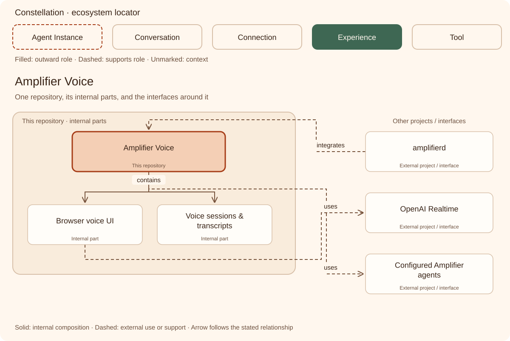

# Amplifier Voice

Talk to Amplifier in your browser. This plugin adds a WebRTC voice interface to
[amplifierd](https://github.com/microsoft/amplifierd), using the OpenAI Realtime API
for conversation and Amplifier agents for delegated tasks.

Audio travels directly between the browser and OpenAI. The plugin manages the
connection, voice sessions, and saved transcripts.

## Get started

You need Python 3.12+, [uv](https://docs.astral.sh/uv/), an OpenAI API key with
Realtime access, and a configured Amplifier provider for delegated work.

Install the standalone app, which includes amplifierd:

```sh
uv tool install amplifierd-plugin-voice \
  --from "git+https://github.com/microsoft/amplifier-voice[standalone]"
```

Set your OpenAI key in the server environment:

```sh
export OPENAI_API_KEY=your-key
```

Configure an Amplifier provider in `~/.amplifier/settings.yaml`. For example, with
`ANTHROPIC_API_KEY` set in that environment:

```yaml
config:
  providers:
    - module: anthropic
      api_key: ${ANTHROPIC_API_KEY}
```

Then start the app:

```sh
amplifier-voice
```

Open [http://127.0.0.1:8410/voice/](http://127.0.0.1:8410/voice/) and allow microphone
access. Voice and delegated model use are billed by their respective providers.

## Add it to an existing daemon

```sh
uv tool install amplifierd \
  --from git+https://github.com/microsoft/amplifierd \
  --with git+https://github.com/microsoft/amplifier-voice
amplifierd serve
```

The daemon discovers the plugin automatically.

## Configuration and access

| Setting | Purpose |
| --- | --- |
| `AMPLIFIER_VOICE_MODEL` | Select the Realtime model. |
| `AMPLIFIER_VOICE_VOICE` | Choose a voice; the default is `ash`. |
| `AMPLIFIER_VOICE_ASSISTANT_NAME` | Change the name shown in the interface. |
| `AMPLIFIER_WORKSPACE_ROOT` | Set the trusted working directory for agent tasks. |
| `VOICE_PLUGIN_HOME_DIR` | Choose transcript storage; defaults to `~/.amplifier-voice`. |
| `VOICE_PLUGIN_PUBLIC_ORIGIN` | Set the exact browser-facing origin; defaults to `http://127.0.0.1:8410`. |

Keep the default loopback setup for local use. Changing hostname, port, or HTTPS
requires a matching `VOICE_PLUGIN_PUBLIC_ORIGIN`; it does not change automatically
with the listening address. Reload the page after restarting the server.

For remote access, use an authenticated HTTPS proxy that protects every `/voice/`
route, preserves the public Host and browser Origin, and isolates the loopback
backend. Origin checks are not user authentication. Use one process and one
browser-facing origin per instance: this is a single-user, single-active-session
interface. See [amplifierd hosting](https://github.com/microsoft/amplifierd/blob/main/docs/HOSTING.md)
for the daemon's deployment controls.

## Development

Install a checkout with `uv sync --extra dev --extra test`, then run `uv run pytest`.
The [package configuration](pyproject.toml) lists the plugin entry point and
optional dependencies.


<!-- ecosystem-map:start -->
## Where this fits

A WebRTC voice experience installed as an amplifierd plugin, with separately configured delegated agents.

Roles: Experience. Supports: Agent Instance.



[Open the map](docs/ecosystem-map.svg) · [Product overview](https://microsoft.github.io/amplifier-constellation/projects/amplifier-voice/) · [Map guide](https://github.com/microsoft/amplifier-constellation/blob/main/docs/ecosystem-maps.md)

<details>
<summary>The five shared building blocks</summary>

[](https://microsoft.github.io/amplifier-constellation/)

</details>

<!-- ecosystem-map:end -->

## Contributing

Most contributions require you to agree to a
Contributor License Agreement (CLA) declaring that you have the right to, and actually do, grant us
the rights to use your contribution. For details, visit [Contributor License Agreements](https://cla.opensource.microsoft.com).

When you submit a pull request, a CLA bot will automatically determine whether you need to provide
a CLA and decorate the PR appropriately (e.g., status check, comment). Simply follow the instructions
provided by the bot. You will only need to do this once across all repos using our CLA.

This project has adopted the [Microsoft Open Source Code of Conduct](https://opensource.microsoft.com/codeofconduct/).
For more information see the [Code of Conduct FAQ](https://opensource.microsoft.com/codeofconduct/faq/) or
contact [opencode@microsoft.com](mailto:opencode@microsoft.com) with any additional questions or comments.

## Trademarks

This project may contain trademarks or logos for projects, products, or services. Authorized use of Microsoft
trademarks or logos is subject to and must follow
[Microsoft's Trademark & Brand Guidelines](https://www.microsoft.com/legal/intellectualproperty/trademarks/usage/general).
Use of Microsoft trademarks or logos in modified versions of this project must not cause confusion or imply Microsoft sponsorship.
Any use of third-party trademarks or logos are subject to those third-party's policies.
